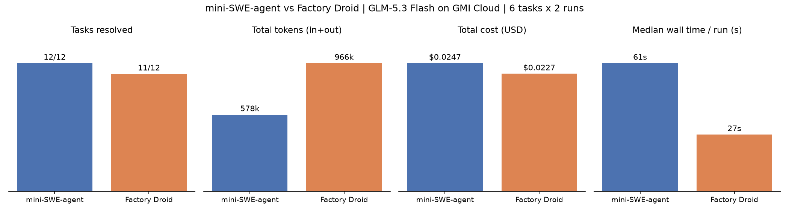

# gmi-agent-bench: mini-SWE-agent vs Factory Droid on GMI Cloud

Two coding agents, one model, the same tasks. Which one fixes more bugs, and which one burns fewer tokens doing it?

- **[mini-SWE-agent](https://github.com/SWE-agent/mini-swe-agent)**: the ~100-line, bash-only agent from the SWE-bench / SWE-agent team (stock `DefaultAgent` + `mini.yaml` prompts, v2.4.6).
- **[Factory Droid](https://factory.ai)**: Factory's terminal coding agent, run headless with `droid exec` (v1.10.0), BYOK custom model.
- **Model**: both call the same model, served by [GMI Cloud](https://www.gmicloud.ai)'s OpenAI-compatible inference API (`https://api.gmi-serving.com/v1`). Default: `zai-org/GLM-5.3-Flash`.

Built as part of the GMI Cloud Clouders ambassador programme. Tag: [@gmi_cloud](https://x.com/gmi_cloud). This project is independent; it is not made by GMI Cloud, Factory or the SWE-agent team.

## Results

Real run on 2026-11-26: 6 tasks x 2 runs per agent, `zai-org/GLM-5.3-Flash` on GMI Cloud for both.



<!-- RESULTS:START -->
| Agent | Resolved | Tests passed | Median wall time (s) | Median steps | Total tokens (in+out) | Cached share of input | Total cost (USD) | Cost per solve (USD) |
| --- | ---: | ---: | ---: | ---: | ---: | ---: | ---: | ---: |
| mini-SWE-agent | **12/12** | **156/156** | 61.2 | 10 | **578k** | 86% | 0.0247 | 0.0021 |
| Factory Droid | 11/12 | 155/156 | **27.1** | **7** | 966k | 95% | **0.0227** | 0.0021 |
<!-- RESULTS:END -->

**What it shows**

- **Score: basically a tie, mini edges it.** mini-SWE-agent solved 12/12 runs. Droid solved 11/12; its one miss (`deep-merge`, run 2) returned a dict that still shared a nested list with the input, which the issue forbids. One run on six tasks is within noise.
- **Speed and steps: Droid wins clearly.** Median 27 s vs 61 s per task (2.3x faster), 7 vs 10 model calls, and about 60% fewer output tokens. Droid batches work into fewer, more targeted tool calls (`Edit`, `Execute`, `Read`) where mini works through one bash command per step.
- **Tokens: mini wins.** Droid used 1.7x the tokens (966k vs 578k). Every Droid request carries about 10k tokens of system prompt and 11 tool schemas, against mini's single `bash` tool.
- **Cost: a wash.** 95% of Droid's input tokens were cache hits ($0.015/M against $0.075/M uncached on GMI), so its larger prompts cost about the same: $0.0227 vs $0.0247 in total and the same cost per solve. Without prompt caching, the same tokens would have cost $0.077 for Droid vs $0.052 for mini, so Droid would be about 1.5x more expensive.
- **The whole benchmark cost under 5 cents** on GMI Cloud (GLM-5.3 Flash promo pricing).

Full per-task and per-run tables: [`results/latest/RESULTS.md`](results/latest/RESULTS.md); raw data: [`results/latest/results.csv`](results/latest/results.csv); every run's logs, request log, trajectory and diff are under `results/latest/raw/`.

Run notes:
- The first version of the `deep-merge` issue listed its bugs in a way that read as if list *concatenation* was wanted; both agents concatenated in run 1 and failed one test. The wording was fixed (`tasks/deep-merge/issue.md`) and run 1 was rerun for **both** agents; run 2 already used the fixed text. The superseded run-1 logs are kept in `results/latest/superseded/`.
- No API errors, timeouts or test edits in any scored run. Steps and tokens measured by the proxy matched each agent's own report exactly.

## Methodology

### Task set

Six small, self-contained Python bug-fix tasks in `tasks/`. Each is a tiny repo with a bug, a user-style issue, a few visible passing tests, and **hidden tests** the agent never sees:

| Task | Bug | Hidden+visible tests |
| --- | --- | ---: |
| `semver-compare` | string comparison of versions, no pre-release / build-metadata rules | 19 |
| `merge-intervals` | touching, unsorted and nested intervals mishandled; input mutated | 11 |
| `lru-cache` | `get` doesn't refresh recency, updates evict, no validation | 9 |
| `parse-duration` | only `"XhYm"` parses; no `d`/`s`, decimals, whitespace, validation | 20 |
| `csv-split` | quoted separators and doubled quotes break (stdlib `csv` banned) | 11 |
| `deep-merge` | nested dicts replaced, input mutated, `None`-deletes missing | 8 |

`pytest tests/test_harness.py` checks that every buggy repo **fails** and every reference `solution/` **passes**, so the scorer is validated.

Why not SWE-bench? Those instances need per-repo Docker images and a much bigger budget; this is meant to be cheap enough for anyone with a GMI key to rerun in minutes. Swapping in SWE-bench Lite instances is a natural next step (mini-SWE-agent ships `mini-extra swebench`).

### Fairness controls

| Control | How |
| --- | --- |
| Same model | One `model.id` in `bench.yaml` used by both agents |
| Same prompt | Identical task prompt (`bench/tasks.py: PROMPT`), passed as mini's `task` and as Droid's `--file`. Each agent keeps its own system prompt and tools; that scaffold *is* what is being compared |
| Same starting state | Fresh copy of the task repo + `git init` baseline per run |
| Same limits | 600 s wall clock per run for both (process-group kill). mini also has its own 40-step cap; Droid has no step flag |
| Same metering | Both agents talk to a local **metering proxy** (`bench/proxy.py`) that forwards to GMI and logs every chat-completions call. Steps and tokens come from that log, not from each tool's self-report (self-reports are kept in `agent_*` CSV columns as a cross-check) |
| Same scorer | After the run the original `tests/` are restored (editing tests can't help), hidden tests are added, `pytest` runs in a clean env. Resolved = all tests pass |
| Order effects | Runs are interleaved (task 1 mini, task 1 droid, task 2 mini, ...) so provider latency drift hits both |
| Secrets | The GMI key lives only in the proxy process. It is removed from both agents' environments and is never written to Droid's settings file |

### Metrics

- **Resolved**: tasks where all visible + hidden tests pass. Also **tests passed** (partial credit).
- **Wall time**: seconds for the agent process only.
- **Steps**: successful chat-completions calls seen by the proxy.
- **Tokens**: prompt / cached / completion tokens from the provider's `usage` field.
- **Cost (USD)**: `uncached_in x input price + cached_in x cached price + out x output price`, prices in `bench.yaml` (GLM-5.3 Flash on GMI, verified 2026-11-26 from GMI's public model catalog: $0.075 in / $0.015 cached / $0.25 out per 1M tokens, a 50% promo off $0.15 / $0.03 / $0.50).

### Agent configuration

- mini-SWE-agent: `DefaultAgent`, `LitellmModel` with `model_name=openai/<id>` and `api_base` = proxy, `LocalEnvironment` in the task dir, built-in `mini.yaml` templates, `step_limit=40`, no cost limit (cost is computed by the harness).
- Droid: `droid exec --settings <file> --model custom:<Display-Name>-0 --auto medium --output-format json --cwd <task> --file <prompt>`, run with a fresh `HOME` so only this run's custom model (provider `generic-chat-completion-api`, per [GMI's Factory guide](https://docs.gmicloud.ai/coding-tools/factory)) is loaded. No `--skip-permissions-unsafe`.

## Reproduce

Requirements: Linux or macOS, Python 3.10+, git, a [GMI Cloud](https://console.gmicloud.ai) API key, and the Droid CLI.

```bash
git clone <this repo> && cd gmi-agent-bench
make setup                                   # venv + mini-swe-agent 2.4.6
curl -fsSL https://app.factory.ai/cli | sh   # Droid CLI (glibc Linux or macOS)
cp .env.example .env                         # put GMI_API_KEY=... in .env (or export it)

make test       # harness unit tests + end-to-end dry run of both agents (no key needed)
make dry-run    # both real agents on all 6 tasks against the scripted mock LLM
make check      # pings GMI with your key and checks droid + mini are installed
make run        # the real benchmark -> results/latest/{results.csv,RESULTS.md}
```

Options: `python -m bench run --agents mini --tasks lru-cache,csv-split --runs 3`. To try another GMI model, change `model:` in `bench.yaml` (id from the [GMI text catalog](https://docs.gmicloud.ai/model-quickstarts/text/overview) plus its prices).

A full run (6 tasks x 2 agents x 2 runs) on GLM-5.3 Flash took about 21 minutes and cost about $0.05.

## Layout

```
bench.yaml            model, prices, limits
bench/
  __main__.py         CLI: check / run / report
  runner.py           per-run loop: workdir -> proxy -> agent -> diff -> score
  agents.py           mini and droid launchers (timeouts, env scrubbing, result parsing)
  mini_entry.py       runs stock mini-swe-agent in a subprocess
  proxy.py            metering proxy (streaming + non-streaming usage capture)
  mockllm.py          scripted OpenAI-compatible server for dry runs
  tasks.py            task loading, workdir prep, hidden-test scoring
  report.py           results.csv + RESULTS.md
tasks/<id>/           repo/, issue.md, hidden_tests/, solution/
results/<name>/       runs.jsonl, results.csv, RESULTS.md, raw/<task>/<agent>/run-NN/{agent.log,requests.jsonl,junit.xml,meta.json,...}
tests/                harness tests
```

## Limitations

- Six small tasks is a smoke-scale benchmark, not a leaderboard. Treat a 1-task difference as noise; run `--runs 3+` before drawing conclusions.
- One model. Agents can rank differently on other models.
- Droid makes any auxiliary model calls it wants (they are counted, since they cost money); mini makes exactly one call per step.
- Prices change; the cost column is only as current as `bench.yaml` (GLM-5.3 Flash was on a 50% promo when this ran).
- mini's wall time includes about 3 s of Python/litellm start-up per run.

## License

MIT
