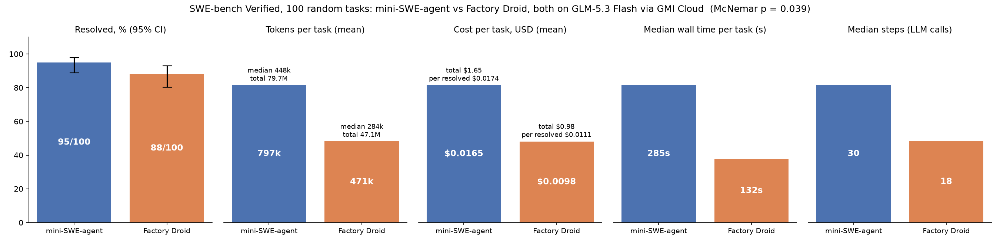

# gmi-agent-bench: mini-SWE-agent vs Factory Droid on GMI Cloud

Two coding agents, one model, real GitHub issues. Which one fixes more bugs, and which one burns fewer tokens doing it?

- **[mini-SWE-agent](https://github.com/SWE-agent/mini-swe-agent)**: the ~100-line, bash-only agent from the SWE-bench / SWE-agent team (stock `DefaultAgent` with its built-in `swebench.yaml`, v2.4.6).
- **[Factory Droid](https://factory.ai)**: Factory's terminal coding agent, run headless with `droid exec` (v1.10.0) using its own (bring-your-own-key) custom-model support.
- **Model**: both call the same model, `zai-org/GLM-5.3-Flash`, served by [GMI Cloud](https://www.gmicloud.ai)'s OpenAI-compatible API (`https://api.gmi-serving.com/v1`).

Built as part of the GMI Cloud Clouders ambassador programme. Tag: [@gmi_cloud](https://x.com/gmi_cloud). This project is independent; it is not made by GMI Cloud, Factory or the SWE-agent team.

## Main result: SWE-bench Verified, 100 random instances



| Agent | Resolved (95% CI) | Total tokens | Tokens per task (median / mean) | Total cost | Cost per task (mean) | Cost per resolved task | Median time per task | Median steps |
| --- | ---: | ---: | ---: | ---: | ---: | ---: | ---: | ---: |
| mini-SWE-agent | **95/100** (89–98%) | 79.7M | 448k / 797k | $1.65 | $0.0165 | $0.0174 | 285 s | 30 |
| Factory Droid | 88/100 (80–93%) | **47.1M** | **284k / 471k** | **$0.98** | **$0.0098** | **$0.0111** | **132 s** | **18** |

Tokens are input + output as metered by the relay (96–97% of input tokens were prompt-cache hits). Cost uses GMI's GLM-5.3 Flash price: $0.075 input / $0.015 cached / $0.25 output per 1M tokens.

Paired on the same 100 instances: both resolved 87, **only mini-SWE-agent 8**, only Droid 1, neither 4. Exact McNemar test: **p = 0.039**.

**What it shows**

- **mini-SWE-agent scores higher.** 95% vs 88% resolved. On the 9 instances where the agents disagreed, mini won 8 to 1 (p = 0.039, significant at 0.05). Six of the eight were Django. In each of mini's wins, Droid's patch applied cleanly but failed the issue's hidden tests: Droid stopped after a quick, plausible fix (a median of about 12 steps on those instances) while mini's reproduce-then-test-edge-cases loop caught the incomplete cases.
- **Factory Droid is about twice as efficient.** Median 132 s vs 285 s per instance, 18 vs 30 model calls, 40% fewer total tokens, and 41% lower cost ($0.98 vs $1.65 for 100 instances). Cost per *resolved* instance is still lower for Droid ($0.011 vs $0.017).
- **Both are cheap on GMI.** The whole 100-instance, two-agent run cost **$2.79** on GLM-5.3 Flash, thanks to 96–97% prompt-cache hits.
- **Pick by what you're optimizing.** If correctness on the first try matters most, mini-SWE-agent's slower, test-heavy loop wins. If throughput and cost matter, Droid gets 88% of issues for 60% of the price in half the time.

Full tables (per repo, per instance): [`results/swebench/main/RESULTS.md`](results/swebench/main/RESULTS.md). Raw data: [`results.csv`](results/swebench/main/results.csv). Each run's relay log, agent log, trajectory (mini), patch and official harness `report.json` are under `results/swebench/main/`.

### SWE-bench methodology

| | |
| --- | --- |
| Instances | First 100 of a seeded random order (`random.Random(20261126)`) over all 500 SWE-bench Verified instances, listed in [`swebench/instances.txt`](swebench/instances.txt). No difficulty filter (sample: 46 under 15 min, 46 15 min to 1 h, 8 1–4 h by SWE-bench's difficulty labels). Any prefix of the list is itself a uniform random sample |
| Environment | Official prebuilt SWE-bench images (`swebench/sweb.eval.x86_64.*`), a fresh container per agent per instance, same env vars for both |
| mini-SWE-agent | Stock `DefaultAgent` with built-in `swebench.yaml` prompts, `LitellmModel` → relay → GMI, `DockerEnvironment` in `/testbed`; step cap 100, wall cap 1200 s |
| Droid | Droid binary copied into the instance container, run as `droid exec --skip-permissions-unsafe --output-format json` with an isolated `HOME` holding a one-model settings file (relay → GMI). The same problem statement, wrapped in the same "change non-test files in /testbed" instructions. Wall cap 1200 s (Droid has no step setting) |
| Patch | Same extraction for both: `git diff HEAD` of tracked files plus new non-test files in subdirectories (`bench/swe_common.py`) |
| Scoring | Official `swebench` 5.0.2 harness (`run_evaluation`) in local Docker. Checked first with the gold patch (resolved) and a no-op patch (unresolved): [`swebench/CONTROLS.md`](swebench/CONTROLS.md) |
| Fairness | Agents ran in alternating order per instance (mini first on even indices, Droid first on odd), up to 10 instances in parallel, each agent behind its own metering relay. Steps and tokens come from the relay and matched each agent's own report on all 200 runs |
| Pilot | 5 instances first to choose the model: GLM-5.3 Flash resolved 5/5 for both agents, so no stronger model was needed. Pilot runs are included in the 100 |

Caveats:
- Resolve rates this high (88–95%) are well above most public SWE-bench Verified results. The scorer passed both controls, so this is a property of the model + scaffold on this sample. Some of it may be contamination: SWE-bench Verified has been public since 2024, and newer models may have seen these fixes in training. The *comparison* between agents is unaffected, because both used the same model.
- Wall times were measured with up to 10 instances sharing an 8-core box (load peaked around 20). Both agents ran interleaved under the same load, so the ratio is fair, but absolute seconds would be lower on an idle machine.
- mini hit its own caps on 5 runs (3 time, 2 step); 3 of those still resolved. Droid hit no caps.
- 7 runs saw a transient GMI 502 (TLS EOF or closed connection); the agents' built-in retries recovered and all 7 produced scored patches. Once, every in-flight GMI request stalled for over 10 minutes; those attempts were thrown away and rerun from scratch, and their $0.16 of spend is included in the total. The relay now times out upstream reads after 180 s so agents retry.
- One model, one sample of 100, one run per instance. A different model could rank the agents differently.

## Sanity suite: 6 small bug-fix tasks

Small self-written tasks (see [Methodology](#methodology-sanity-suite)), run first as a smoke test on 2026-11-26: 6 tasks x 2 runs per agent, `zai-org/GLM-5.3-Flash` on GMI Cloud for both.


<!-- RESULTS:START -->
| Agent | Resolved | Tests passed | Median wall time (s) | Median steps | Total tokens (in+out) | Cached share of input | Total cost (USD) | Cost per solve (USD) |
| --- | ---: | ---: | ---: | ---: | ---: | ---: | ---: | ---: |
| mini-SWE-agent | **12/12** | **156/156** | 61.2 | 10 | **578k** | 86% | 0.0247 | 0.0021 |
| Factory Droid | 11/12 | 155/156 | **27.1** | **7** | 966k | 95% | **0.0227** | 0.0021 |
<!-- RESULTS:END -->

**What it showed** (superseded by the SWE-bench run above, which agrees on efficiency and gives a statistically meaningful score comparison)

- **Score: basically a tie, mini edges it.** mini-SWE-agent solved 12/12 runs. Droid solved 11/12; its one miss (`deep-merge`, run 2) returned a dict that still shared a nested list with the input, which the issue forbids. One run on six tasks is within noise.
- **Speed and steps: Droid wins clearly.** Median 27 s vs 61 s per task (2.3x faster), 7 vs 10 model calls, and about 60% fewer output tokens. Droid batches work into fewer, more targeted tool calls (`Edit`, `Execute`, `Read`) where mini works through one bash command per step.
- **Tokens: mini wins.** Droid used 1.7x the tokens (966k vs 578k). Every Droid request carries about 10k tokens of system prompt and 11 tool schemas, against mini's single `bash` tool.
- **Cost: a wash.** 95% of Droid's input tokens were cache hits ($0.015/M against $0.075/M uncached on GMI), so its larger prompts cost about the same: $0.0227 vs $0.0247 in total and the same cost per solve. Without prompt caching, the same tokens would have cost $0.077 for Droid vs $0.052 for mini, so Droid would be about 1.5x more expensive.
- **The whole benchmark cost under 5 cents** on GMI Cloud (GLM-5.3 Flash promo pricing).

Full per-task and per-run tables: [`results/latest/RESULTS.md`](results/latest/RESULTS.md); raw data: [`results/latest/results.csv`](results/latest/results.csv); every run's logs, request log, trajectory and diff are under `results/latest/raw/`.

Run notes:
- The first version of the `deep-merge` issue listed its bugs in a way that read as if list *concatenation* was wanted; both agents concatenated in run 1 and failed one test. The wording was fixed (`tasks/deep-merge/issue.md`) and run 1 was rerun for **both** agents; run 2 already used the fixed text. The superseded run-1 logs are kept in `results/latest/superseded/`.
- No API errors, timeouts or test edits in any scored run. Steps and tokens measured by the proxy matched each agent's own report exactly.

## Methodology (sanity suite)

### Task set

Six small, self-contained Python bug-fix tasks in `tasks/`. Each is a tiny repo with a bug, a user-style issue, a few visible passing tests, and **hidden tests** the agent never sees:

| Task | Bug | Hidden+visible tests |
| --- | --- | ---: |
| `semver-compare` | string comparison of versions, no pre-release / build-metadata rules | 19 |
| `merge-intervals` | touching, unsorted and nested intervals mishandled; input mutated | 11 |
| `lru-cache` | `get` doesn't refresh recency, updates evict, no validation | 9 |
| `parse-duration` | only `"XhYm"` parses; no `d`/`s`, decimals, whitespace, validation | 20 |
| `csv-split` | quoted separators and doubled quotes break (stdlib `csv` banned) | 11 |
| `deep-merge` | nested dicts replaced, input mutated, `None`-deletes missing | 8 |

`pytest tests/test_harness.py` checks that every buggy repo **fails** and every reference `solution/` **passes**, so the scorer is validated.

Why not SWE-bench? Those instances need per-repo Docker images and a much bigger budget; this is meant to be cheap enough for anyone with a GMI key to rerun in minutes. Swapping in SWE-bench Lite instances is a natural next step (mini-SWE-agent ships `mini-extra swebench`).

### Fairness controls

| Control | How |
| --- | --- |
| Same model | One `model.id` in `bench.yaml` used by both agents |
| Same prompt | Identical task prompt (`bench/tasks.py: PROMPT`), passed as mini's `task` and as Droid's `--file`. Each agent keeps its own system prompt and tools; that scaffold *is* what is being compared |
| Same starting state | Fresh copy of the task repo + `git init` baseline per run |
| Same limits | 600 s wall clock per run for both (process-group kill). mini also has its own 40-step cap; Droid has no step flag |
| Same metering | Both agents talk to a local **metering proxy** (`bench/proxy.py`) that forwards to GMI and logs every chat-completions call. Steps and tokens come from that log, not from each tool's self-report (self-reports are kept in `agent_*` CSV columns as a cross-check) |
| Same scorer | After the run the original `tests/` are restored (editing tests can't help), hidden tests are added, `pytest` runs in a clean env. Resolved = all tests pass |
| Order effects | Runs are interleaved (task 1 mini, task 1 droid, task 2 mini, ...) so provider latency drift hits both |
| Secrets | The GMI key lives only in the proxy process. It is removed from both agents' environments and is never written to Droid's settings file |

### Metrics

- **Resolved**: tasks where all visible + hidden tests pass. Also **tests passed** (partial credit).
- **Wall time**: seconds for the agent process only.
- **Steps**: successful chat-completions calls seen by the proxy.
- **Tokens**: prompt / cached / completion tokens from the provider's `usage` field.
- **Cost (USD)**: `uncached_in x input price + cached_in x cached price + out x output price`, prices in `bench.yaml` (GLM-5.3 Flash on GMI, verified 2026-11-26 from GMI's public model catalog: $0.075 in / $0.015 cached / $0.25 out per 1M tokens, a 50% promo off $0.15 / $0.03 / $0.50).

### Agent configuration

- mini-SWE-agent: `DefaultAgent`, `LitellmModel` with `model_name=openai/<id>` and `api_base` = proxy, `LocalEnvironment` in the task dir, built-in `mini.yaml` templates, `step_limit=40`, no cost limit (cost is computed by the harness).
- Droid: `droid exec --settings <file> --model custom:<Display-Name>-0 --auto medium --output-format json --cwd <task> --file <prompt>`, run with a fresh `HOME` so only this run's custom model (provider `generic-chat-completion-api`, per [GMI's Factory guide](https://docs.gmicloud.ai/coding-tools/factory)) is loaded. No `--skip-permissions-unsafe`.

## Reproduce

Requirements: Linux, Python 3.10+, git, Docker (about 100 GB free disk for SWE-bench images), a [GMI Cloud](https://console.gmicloud.ai) API key, and the Droid CLI.

```bash
git clone <this repo> && cd gmi-agent-bench
make setup                                   # venv + mini-swe-agent 2.4.6
.venv/bin/pip install swebench datasets      # SWE-bench track
curl -fsSL https://app.factory.ai/cli | sh   # Droid CLI (glibc Linux)
cp .env.example .env                         # put GMI_API_KEY=... in .env (or export it)

make test       # harness tests + end-to-end dry run of both agents (no key needed)
make check      # pings GMI with your key, checks droid + mini

# SWE-bench Verified (resumable: rerun the same command after an interruption)
.venv/bin/python -m bench.swe run --n 5   --workers 3  --out results/swebench/pilot   # pilot
.venv/bin/python -m bench.swe run --n 100 --workers 10 --budget 20 --out results/swebench/main
.venv/bin/python -m bench.swe report --out results/swebench/main && .venv/bin/python -m bench.swe_chart results/swebench/main

# Sanity suite (6 small tasks)
make run        # -> results/latest/{results.csv,RESULTS.md}
```

`--budget` is a hard cap: the relays refuse new GMI calls once recorded spend (including earlier interrupted attempts) reaches it. To try another GMI model: `--model-id <id> --display-name <name> --price-in <$/M> --price-cached <$/M> --price-out <$/M>`.

The 100-instance run took about 3 h of wall time on an 8-core box (10 workers for most of it) and cost $2.79.

## Layout

```
bench.yaml            model, prices, limits
bench/
  __main__.py         CLI: check / run / report
  runner.py           per-run loop: workdir -> proxy -> agent -> diff -> score
  agents.py           mini and droid launchers (timeouts, env scrubbing, result parsing)
  mini_entry.py       runs stock mini-swe-agent in a subprocess
  proxy.py            metering proxy (streaming + non-streaming usage capture)
  mockllm.py          scripted OpenAI-compatible server for dry runs
  tasks.py            task loading, workdir prep, hidden-test scoring
  report.py           results.csv + RESULTS.md
  swe.py              SWE-bench Verified driver (pull, both agents, patch, official scoring, budget cap)
  swe_mini_entry.py   stock mini-swe-agent on one SWE-bench instance (DockerEnvironment)
  swe_common.py       shared container env + patch-extraction rule
  swe_report.py       Wilson CIs, McNemar, per-repo tables
  swe_chart.py / chart.py   charts
swebench/             instances.txt (seeded order), select_instances.py, CONTROLS.md
tasks/<id>/           repo/, issue.md, hidden_tests/, solution/
results/swebench/main/  runs.jsonl, results.csv, RESULTS.md, chart.png, raw/<instance>/<agent>/, eval/logs/ (official reports)
results/<name>/       runs.jsonl, results.csv, RESULTS.md, raw/<task>/<agent>/run-NN/{agent.log,requests.jsonl,junit.xml,meta.json,...}
tests/                harness tests
```

## Limitations

- Sanity suite: six small tasks is a smoke test, not a leaderboard. Treat a 1-task difference there as noise.
- One model. Agents can rank differently on other models.
- Droid makes any auxiliary model calls it wants (they are counted, since they cost money); mini makes exactly one call per step.
- Prices change; the cost column is only as current as `bench.yaml` (GLM-5.3 Flash was on a 50% promo when this ran).
- mini's wall time includes about 3 s of Python/litellm start-up per run.

## License

MIT
